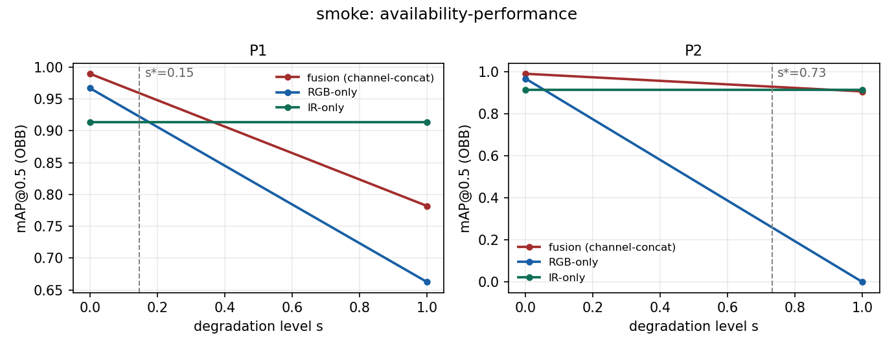

<p align="center">
  <a href="#english">English</a> &nbsp;·&nbsp; <a href="#chinese">简体中文</a>
</p>

<a name="english"></a>

# uav-modality-decay

Diagnosing negative fusion under continuous modality decay in UAV RGB-IR oriented object detection.

## The question

Paired visible/infrared detectors are trained and benchmarked with both streams healthy. In deployment
one stream degrades — low light, lens contamination, misregistration — while the other remains usable.
Does fusion still beat simply discarding the bad stream, and where does it stop doing so?

```
NF(s) = mAP_fusion(s) − max(mAP_rgb_only(s), mAP_ir_only(s))
```

`NF < 0` means the fused model is worse than the better single modality. `s*` is the crossing point,
and the project asks whether `s*` moves with imaging conditions.

## Status

| Part | State |
|---|---|
| Pipeline (prepare → train → degrade → evaluate → curves) | working |
| Synthetic smoke test | passing |
| Real ATR-UMOD pilot | in progress |
| Reliability routing (method) | not implemented |

Synthetic runs exist only to verify that data conversion, training, degradation, metric computation
and plotting are wired correctly. They are not evidence for the research claim.

## Install

```bash
git clone https://github.com/kimYe121/uav-modality-decay.git
cd uav-modality-decay
pip install -e .
```

Python 3.10+. Training needs a CUDA-capable GPU; evaluation and the synthetic smoke test run on CPU.

## Quick start

```bash
python scripts/check_env.py      # torch / CUDA / ultralytics sanity check
python scripts/run_smoke.py      # synthetic end-to-end run, a few minutes
```

Outputs: `results/*_results.csv`, `results/*_summary.txt`, `results/*_curves.png`.



A synthetic wiring check, not a result: the fusion curve starts above both single modalities and
crosses the IR-only line at s≈0.15 (contamination) and s≈0.73 (zeroing).

## Data

The experiments use [ATR-UMOD](https://github.com/supercpy/ATR-UMOD) (ICCV 2025): 13,353 registered
RGB–IR pairs, oriented boxes, 11 vehicle classes, six per-image condition attributes. Download it
from the link in that repository (the paper's Baidu Pan code is `accd`) and unpack to:

```
data/ATR-UMOD/
├── train/
│   ├── images/       # visible
│   ├── images_ir/    # infrared (grayscale)
│   ├── labels/       # VOC-style XML, visible
│   └── labels_ir/    # VOC-style XML, infrared
└── test/
    └── (same structure)
```

Convert to YOLO-OBB and carve a validation split by scene:

```bash
python scripts/prepare_atr.py check   --root data/ATR-UMOD
python scripts/prepare_atr.py convert --root data/ATR-UMOD --out data/atr_umod
```

`check` prints class names, instance counts, coordinate arity and attribute fields before anything is
written. Do not split by random frame: adjacent frames from one flight are near-duplicates and inflate
validation scores. Report mean ± std over at least three seeds.

## Degradation protocols

| Protocol | Operation | What stays intact |
|---|---|---|
| P1 contamination | low light + read noise, fog scattering, blur, or additive noise on RGB | IR untouched |
| P2 zeroing | RGB driven toward black | IR untouched |
| P3 misregistration | IR frame translated by 2–20 px | both images individually clean |

P1/P2 reduce single-modality quality. P3 keeps each stream's own quality at 1.0 and only breaks
cross-modal correspondence — the case a single-modality quality score cannot catch.

## Model views

| View | Input |
|---|---|
| `rgb` | visible only |
| `ir` | infrared only (grayscale replicated to three channels) |
| `fused` | RGB with IR injected into the B channel (channel-concat proxy) |

The fusion proxy is intentionally minimal: it cannot reweight a degraded stream, which is the failure
mode under study. A learned two-stream baseline replaces it in the full experiments. Pixel averaging
was tried first and abandoned — it preserves the clean stream's information and hides the effect,
which locates the phenomenon at the feature level rather than the pixel level.

## Metrics

- `RA(s) = mAP(s) / mAP(clean)` — resistance ability, following MultiCorrupt
- `NF(s)` — negative fusion gap, defined above
- `s*` — first sign change of `NF`, linear interpolation between levels
- slope of `mAP` against `s` — the weaker claim when no crossing occurs

## Project layout

```
configs/                 experiment configs (smoke, pilot)
docs/                    figures referenced by this README
scripts/                 entry points: env check, data prep, smoke and pilot runs
src/modality_decay/      package: synth, degrade, datasets, train, evaluate, metrics, plots
```

## References

- ATR-UMOD / PCDF, ICCV 2025 — dataset and condition-aware fusion baseline
- M²D-LIF, ICCV 2025 — names fusion degradation
- RSC-MD, arXiv 2511.15433 — gradient-suppression account of fusion degradation
- MultiCorrupt, arXiv 2402.11677 — RA / RRA corruption-robustness metrics
- Ultra-Fusion, arXiv 2606.21223 — factor-wise reliability scheduling in SLAM
- DRNet — dynamic routing under missing modalities

## License

MIT — see [LICENSE](LICENSE).

---

<a name="chinese"></a>

# uav-modality-decay

面向无人机 RGB-IR 旋转框目标检测：连续模态衰减下的负融合诊断。

## 研究问题

成对的可见光/红外检测器通常在双路完好的数据上训练与评测。真实部署中，一路会退化——低照度、
镜头污染、配准漂移——而另一路仍然可用。此时融合是否还优于「干脆丢掉坏的那一路」？从哪里开始不优？

```
NF(s) = mAP_fusion(s) − max(mAP_rgb_only(s), mAP_ir_only(s))
```

`NF < 0` 表示融合模型比更好的单模态还差，`s*` 是二者的交点，本项目要问的是这个交点是否随成像条件移动。

## 进展

| 模块 | 状态 |
|---|---|
| 全链路（数据准备 → 训练 → 退化 → 评测 → 曲线） | 可用 |
| 合成数据冒烟测试 | 通过 |
| ATR-UMOD 真实 pilot | 进行中 |
| 可靠性路由（方法） | 未实现 |

合成数据只用于验证数据转换、训练、退化、指标与绘图是否接通，**不构成研究结论的证据**。

## 安装

```bash
git clone https://github.com/kimYe121/uav-modality-decay.git
cd uav-modality-decay
pip install -e .
```

需要 Python 3.10 及以上。训练需要 CUDA 显卡；评测与合成冒烟测试可在 CPU 上运行。

## 快速开始

```bash
python scripts/check_env.py      # 检查 torch / CUDA / ultralytics
python scripts/run_smoke.py      # 合成数据全链路，几分钟
```

输出位于 `results/`：`*_results.csv`、`*_summary.txt`、`*_curves.png`。


这是链路验证，不是研究结论：融合曲线起点高于两个单模态，并在 s≈0.15（污染）与 s≈0.73（置零）处
跌破红外单模态那条水平线。

## 数据

实验使用 [ATR-UMOD](https://github.com/supercpy/ATR-UMOD)（ICCV 2025）：13,353 对配准 RGB–IR 图像、
旋转框、11 类车辆目标、每图 6 个成像条件属性。从该仓库提供的链接下载（论文网盘提取码 `accd`），
解压后目录如下：

```
data/ATR-UMOD/
├── train/
│   ├── images/       # 可见光
│   ├── images_ir/    # 红外（单通道灰度）
│   ├── labels/       # VOC 风格 XML，可见光
│   └── labels_ir/    # VOC 风格 XML，红外
└── test/
    └── （结构相同）
```

转换为 YOLO-OBB 并按场景切出验证集：

```bash
python scripts/prepare_atr.py check   --root data/ATR-UMOD
python scripts/prepare_atr.py convert --root data/ATR-UMOD --out data/atr_umod
```

`check` 会在写任何文件之前打印类别名、实例数、坐标点个数与属性字段名，先确认再转换。
**不要按帧随机切分**：同一航次的相邻帧几乎是重复样本，会让验证指标虚高。正式结果至少跑 3 个随机种子，
报 mean ± std。

## 三类退化协议

| 协议 | 操作 | 保持完好的部分 |
|---|---|---|
| P1 污染 | 对可见光施加低照度+读出噪声、雾散射、模糊或加性噪声 | 红外不动 |
| P2 置零 | 可见光被压向全黑 | 红外不动 |
| P3 配准漂移 | 红外帧平移 2–20 px | 两路各自质量都完好 |

P1/P2 降低单路质量；P3 让两路自身质量都保持为 1.0，只破坏跨模态对应关系——这正是单路质量分数
无法捕捉的那一类失效。

## 三种模型视图

| 视图 | 输入 |
|---|---|
| `rgb` | 仅可见光 |
| `ir` | 仅红外（灰度复制为三通道） |
| `fused` | 将红外注入 B 通道的可见光（通道拼接代理） |

融合代理刻意保持最简：它无法对退化的一路重新加权，而这正是要研究的失效模式。正式实验会替换为
可学习的双流基线。此前尝试过像素平均，但它会保留干净一路的信息、把效应掩盖掉，说明现象位于特征层
而非像素层，因此弃用。

## 指标

- `RA(s) = mAP(s) / mAP(clean)`：抗退化能力，沿用 MultiCorrupt
- `NF(s)`：负融合间隙，定义见上
- `s*`：`NF` 首次变号处，档位之间线性插值
- `mAP` 对 `s` 的斜率：曲线不交叉时的弱版本结论

## 目录结构

```
configs/                 实验配置（smoke、pilot）
docs/                    README 引用的图片
scripts/                 入口：环境检查、数据准备、冒烟与 pilot 运行
src/modality_decay/      包：synth、degrade、datasets、train、evaluate、metrics、plots
```

## 参考文献

- ATR-UMOD / PCDF，ICCV 2025：数据集与条件感知融合基线
- M²D-LIF，ICCV 2025：正式命名 fusion degradation
- RSC-MD，arXiv 2511.15433：融合退化的梯度抑制解释
- MultiCorrupt，arXiv 2402.11677：RA / RRA 退化鲁棒性指标
- Ultra-Fusion，arXiv 2606.21223：SLAM 中的因子级可靠性调度
- DRNet：模态缺失下的动态路由

## 许可证

MIT，详见 [LICENSE](LICENSE)。

---

<p align="center">
  <a href="#english">English</a> &nbsp;·&nbsp; <a href="#chinese">简体中文</a>
</p>
